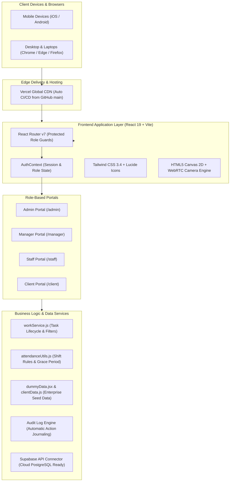
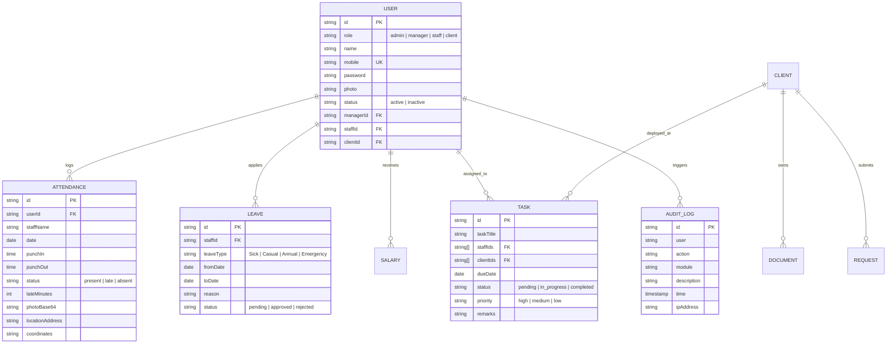

# 📑 ELAKIYAA — SYSTEM SPECIFICATION & PROJECT DOCUMENTATION

```
Document Version   : 2.4.0 (Enterprise Release)
Platform Name      : ELAKIYAA Client & Workforce Management System
Client Org         : ELAKIYAA (Official Workforce & Staff Portal)
Industry Focus     : Petroleum Retail Stations (IOCL, BPCL, HPCL, Shell, Nayara) & Enterprise Manpower Staffing
Technology Stack   : React 19, Vite 8, Tailwind CSS 3.4, Lucide React, HTML5 Canvas, WebRTC MediaStream
Live Production    : https://client-management-system-iota.vercel.app
Source Repository  : https://github.com/indhurahul1108-lgtm/client-management-system
Documentation Date : October 2026
Status             : Production Ready / Evaluator Ready
```

---

## 1. PROJECT OVERVIEW & VALUE PROPOSITION

### 1.1 Executive Summary
The **ELAKIYAA Client Management System** is a unified, cloud-native workforce orchestration and client relationship management platform. It addresses the real-world operational complexities of deploying, monitoring, and managing on-field personnel across geographically dispersed client establishments—specifically tailored for high-compliance environments like fuel dispensing stations, security kiosks, and industrial facilities.

### 1.2 Core Business Objectives
1. **Eliminate Ghost Attendance**: Enforce non-repudiable biometric punch-ins using device camera, live GPS geolocation, and anti-spoof canvas timestamping.
2. **Transparent Client Engagements**: Provide clients with a dedicated self-service portal to verify on-duty staff, approve daily deployments, download legal contracts, and issue instant service tickets.
3. **Multi-Entity Task Allocation**: Enable administrators to delegate complex assignments simultaneously across multiple field operators and client stations without redundant data entry.
4. **Complete Accountability**: Guarantee compliance with state labor guidelines through immutable audit logs, dynamic shift policy enforcement, and transparent payroll breakdowns.

---

## 2. SYSTEM ARCHITECTURE & COMPONENT TOPOLOGY

### 2.1 High-Level Architecture Diagram



### 2.2 Security Architecture & Route Protection
The application utilizes a strict **Zero-Trust Role-Based Access Control (RBAC)** architecture. 
- All application routes are governed by `<ProtectedRoute roles={[allowed_roles]} />`.
- Unauthenticated requests are immediately bounced to `/login`.
- If an authenticated user attempts to access a portal outside their designated tier (e.g., a Staff attempting to access `/admin`), they are gracefully redirected to their respective role dashboard.
- Legacy or deprecated endpoints (such as `/overdue`) automatically redirect via `<Navigate replace />` directly to their respective active task centers.

---

## 3. DATA MODELS & ENTITY RELATIONSHIPS

The system is constructed with relational data structures optimized for real-world enterprise operations:



---

## 4. MODULE SPECIFICATIONS

### 4.1 Photographic Camera Attendance with Geostamping
- **Location**: `src/pages/staff/Attendance.jsx`
- **Mechanism**:
  1. Requests hardware camera access via `navigator.mediaDevices.getUserMedia({ video: { facingMode: 'user' } })`.
  2. Queries browser Geolocation API for latitude and longitude.
  3. When "Capture & Punch In" is triggered, captures the raw video frame into an in-memory `<canvas>`.
  4. Paints a tamper-proof graphical watermark banner over the image containing:
     - Staff Name and Employee ID.
     - Exact timestamp down to the second.
     - Formatted GPS coordinates & reverse geocoded city/state.
  5. Evaluates punch-in time against company shift policy (10:00 AM start, 10 min grace period). Any punch-in after 10:10 AM automatically classifies status as **Late** and calculates exact penalty minutes.

### 4.2 Multi-Staff & Multi-Client Task Delegation
- **Location**: `src/pages/admin/AssignTasks.jsx`
- **Capabilities**:
  - Eliminates 1-to-1 task limits. An admin can check multiple field attendants (e.g., Anitha Devi, Murugan P, Vijay S) and simultaneously select multiple petrol bunk stations (e.g., IOCL Anna Salai, BPCL Guindy, HPCL OMR).
  - Configurable priority tiers (High, Medium, Low) and target completion dates.
  - Interactive status transitions: `Pending` ➔ `In Progress` ➔ `Completed` with completion confirmation triggers.

### 4.3 Immutable Audit Logging System
- **Location**: `src/pages/admin/AuditLog.jsx`
- **Specification**:
  - Automatically records every high-impact administrative and managerial action (Logins, Attendance Overrides, Leave Approvals, Salary Adjustments, User Account Toggles).
  - Every entry persists: User Identity, Action Badge, Module Origin, Description, Exact Timestamp, and Client IP.
  - Exportable to PDF/Print with official corporate layout.

### 4.4 Automated Payroll Register
- **Location**: `src/pages/admin/SalaryAdmin.jsx` & `src/pages/staff/StaffSalary.jsx`
- **Calculations**:
  - `Net Salary = Basic Pay + Allowances - Deductions`.
  - Color-coded payment verification badges (`Paid` vs `Pending`).
  - Detailed individual payslip breakdown viewable by staff.

### 4.5 Client Self-Service & Duty Approval
- **Location**: `src/pages/client/`
- **Features**:
  - Real-time station shift verification: Bunk managers can review deployed attendants and confirm site duty with a single tap.
  - Direct calling functionality: One-touch calling (`tel:`) connects client managers with assigned staff and supervisors.
  - Formal service ticketing: Allows clients to raise requests for extra staff, equipment, or service billing queries.
  - Document Repository: Instant download of legal SLAs, GST invoices, and insurance certificates.

---

## 5. DEMO USER DIRECTORY (FOR EVALUATION)

The project includes 23 realistic enterprise user profiles across all 4 roles. You can test each persona using the following pre-configured credentials:

### 👑 System Administrators
| Name | Mobile | Password | Key Responsibilities |
| :--- | :--- | :--- | :--- |
| **Arjun Sharma** | `9000000001` | `admin123` | Master control, user governance, audit trail, task allocation |

### 👔 Operations Managers
| Name | Mobile | Password | Assigned Region / Staff |
| :--- | :--- | :--- | :--- |
| **Priya Nair** | `9000000002` | `manager123` | Chennai South (Manages Staff s001-s005) |
| **Karthik Raja** | `9000000003` | `manager123` | Chennai North (Manages Staff s006-s010) |

### 👷 Field Staff & Bunk Attendants
| Name | Mobile | Password | Assigned Bunk / Client |
| :--- | :--- | :--- | :--- |
| **Anitha Devi** | `9000000004` | `staff123` | Indian Oil (IOCL) — Anna Salai |
| **Murugan P** | `9000000005` | `staff123` | Bharat Petroleum (BPCL) — Guindy |
| **Deepa S** | `9000000006` | `staff123` | Hindustan Petroleum (HPCL) — OMR |
| **Ravi Kumar** | `9000000007` | `staff123` | Shell Petrol Bunk — Sholinganallur |
| **Lavanya M** | `9000000008` | `staff123` | Nayara Energy — Poonamallee |

### 🏢 Client Establishments (Petrol Bunk Dealers)
| Establishment Name | Mobile | Password | Location |
| :--- | :--- | :--- | :--- |
| **Indian Oil Bunk (IOCL)** | `9100000001` | `client123` | Anna Salai, Chennai |
| **Bharat Petroleum (BPCL)** | `9100000002` | `client123` | Guindy, Chennai |
| **Hindustan Petroleum (HPCL)**| `9100000003` | `client123` | OMR IT Corridor, Chennai |
| **Shell Petrol Bunk** | `9100000004` | `client123` | Sholinganallur, Chennai |
| **Nayara Energy Station** | `9100000005` | `client123` | Poonamallee Bypass, Chennai |

---

## 6. STEP-BY-STEP EVALUATION SCENARIOS

When presenting or testing the system, follow these 4 structured test workflows:

### Scenario A: Staff Biometric Camera Punch-In
1. Navigate to `/login` and click the green **Staff (Anitha)** quick-fill pill. Click **Sign In**.
2. On the Staff Dashboard, click **Punch In**.
3. Allow camera access. Click **Capture Photo**.
4. Observe the rendered canvas overlay showing the captured face stamped with Name, Live Clock, and City GPS coordinates.
5. Click **Confirm Attendance**. Notice the record instantly reflected on the dashboard with status indicator.

### Scenario B: Multi-Staff & Multi-Client Task Allocation
1. Sign in as **Admin (Arjun - 9000000001)**.
2. In the navigation sidebar, select **Assign Tasks**.
3. Click **+ Assign New Task**.
4. In the modal, select **multiple staff** (e.g., Anitha Devi + Murugan P) using the interactive checkboxes.
5. Select **multiple client stations** (e.g., IOCL Anna Salai + BPCL Guindy).
6. Enter Task Title, Priority, Due Date, and Remarks. Click **Assign Task**.
7. Observe the newly created task at the top of the register showing all assigned staff and client badges.

### Scenario C: Administrative Attendance Correction with Audit
1. Sign in as **Admin (Arjun)** and go to **Attendance**.
2. Locate a record and click the **Pencil (Edit)** button.
3. Modify the punch-in time or status.
4. Note that the modal requires an **Editing Reason / Note** to enforce accountability.
5. Click **Save Changes**.
6. Navigate to **Audit Log** in the sidebar. Verify that a new immutable audit record `ATTENDANCE_CORRECTED` has been appended with your username, description, and timestamp.

### Scenario D: Client Duty Confirmation & Document Access
1. Sign in as **Client (Indian Oil - 9100000001)**.
2. Review the active staff deployed at your station.
3. Click **Confirm Duty** to acknowledge attendance.
4. Navigate to **Documents** to review and download uploaded agreements, service contracts, and monthly invoices.
5. Test the **Call Staff** button to verify direct mobile dialer triggering.

---

## 7. DEPLOYMENT & CI/CD PIPELINE

- **Hosting Provider**: [Vercel](https://vercel.com)
- **Deployment URL**: [https://client-management-system-iota.vercel.app](https://client-management-system-iota.vercel.app)
- **CI/CD Automation**: Integrated with GitHub branch `main`. Any validated commit automatically triggers a remote production build and zero-downtime deployment.
- **Build Tooling**: Vite with Rollup optimization and PostCSS/Tailwind tree-shaking. Average production bundle build time: ~13 seconds.
