# 🌟 ELAKIYAA — Client & Workforce Management System

[](https://client-management-system-iota.vercel.app)
[](https://react.dev/)
[](https://vitejs.dev/)
[](https://tailwindcss.com/)
[](https://github.com/indhurahul1108-lgtm/client-management-system)

---

## 📌 Executive Summary

**ELAKIYAA Client & Workforce Management System** is a production-ready enterprise SaaS solution engineered for manpower staffing, client service tracking, and distributed shift management. Originally customized for oil & gas retail networks (IOCL, BPCL, HPCL, Shell, Nayara) and enterprise service providers, it unifies **Admin governance, Manager supervision, Staff operational reporting, and Client transparency** into a seamless, high-performance web platform.

- **🌐 Live Production URL**: [https://client-management-system-iota.vercel.app](https://client-management-system-iota.vercel.app)
- **💻 Source Code Repository**: [https://github.com/indhurahul1108-lgtm/client-management-system](https://github.com/indhurahul1108-lgtm/client-management-system)

---

## 🏢 Business Problem & Solution

| Traditional Industry Challenges | ELAKIYAA Enterprise Solution |
| :--- | :--- |
| **Buddy Punching & False Attendance** | **Biometric Camera & Geo-Stamped Attendance** — Real-time front-camera capture with embedded GPS coordinates, address, and tamper-proof timestamp overlay on HTML5 canvas. |
| **Disconnected Task Allocations** | **Multi-Entity Task Engine** — Single or bulk task assignments across multiple staff members and multiple client stations simultaneously. |
| **Lack of Client Visibility** | **Dedicated Client Portal** — Real-time tracking of assigned staff, shift logs, official document downloads, and service request tracking. |
| **Slow Payroll & Leave Processing** | **Automated Payroll & Leave System** — Leave approval chains with automatic status propagation and detailed salary slip generation (basic, allowances, deductions, net). |
| **Zero Audit Accountability** | **Immutable Audit Trail** — Automatic timestamped logging of every critical administrative action, attendance correction, and role update. |

---

## 👥 Role-Based Portals & Feature Matrix

The platform incorporates comprehensive **Role-Based Access Control (RBAC)** across 4 distinct user tiers:

```mermaid
graph TD
    A[ELAKIYAA Auth Gateway] -->|Role: Admin| B[Admin Portal]
    A -->|Role: Manager| C[Manager Portal]
    A -->|Role: Staff| D[Staff Portal]
    A -->|Role: Client| E[Client Portal]

    B --> B1[User & Staff Management]
    B --> B2[Multi-Entity Task Allocation]
    B --> B3[Attendance & Corrections]
    B --> B4[Payroll & Leave Governance]
    B --> B5[Immutable Audit Log]

    C --> C1[Assigned Staff Roster]
    C --> C2[Client Bunk Oversight]
    C --> C3[Daily Shift Operations]
    C --> C4[Leave Approvals & Work Allocation]

    D --> D1[Selfie + GPS Punch In/Out]
    D --> D2[Work Progress Updates]
    D --> D3[Leave Applications]
    D --> D4[Salary Slips & Documents]

    E --> E1[Bunk Duty Confirmation]
    E --> E2[Assigned Staff Directory & Direct Call]
    E --> E3[Service & Document Requests]
    E --> E4[Invoice & Agreement Repository]
```



### 1. 🛡️ Admin Portal (`/admin`)
- **Executive Dashboard**: Key workforce KPIs, active client counts, daily attendance ratios, and system health.
- **User Governance (`/admin/users`)**: Search, filter, inspect profiles, and activate/deactivate accounts across all 4 tiers without accidental data loss.
- **Staff & Manager Roster (`/admin/staff`, `/admin/managers`)**: Detailed directory with direct telephonic contact (`tel:` protocol) and branch assignments.
- **Client Management (`/admin/clients`)**: Comprehensive management of fuel stations and corporate clients with assigned supervisor tracking.
- **Advanced Task Allocation (`/admin/assign-tasks`)**:
  - Multi-select multiple staff members simultaneously.
  - Multi-select multiple client branches simultaneously.
  - Priority flags (High, Medium, Low), target deadlines, and progress logs.
- **Attendance Control & Audit (`/admin/attendance`)**: View all daily punch-ins with photo thumbnails, late calculations, and administrative correction modal with reason recording.
- **Salary Management (`/admin/salary`)**: Comprehensive salary register with earnings breakdown and exportable records.
- **Audit Logging (`/admin/audit-log`)**: Immutable security trail recording logins, task creations, leave actions, and system modifications with IP and timestamps.

### 2. 👔 Manager Portal (`/manager`)
- **Supervisory Dashboard**: Today's active team presence, pending leave requests, and active operational tasks.
- **Team Roster (`/manager/staff`)**: Inspection of staff members assigned to the manager with attendance history and task workload.
- **Client Station Monitoring (`/manager/clients`)**: Review client satisfaction, assigned personnel, and shift coverage.
- **Leave Authorization (`/manager/leave`)**: Two-way workflow to approve/reject subordinate leave applications and apply for personal managerial leave.
- **Work Orchestration (`/manager/work`)**: Assign tasks directly to team members and monitor real-time completion percentages.

### 3. 👷 Staff Portal (`/staff`)
- **Camera-Verified Punch In/Out (`/staff/attendance`)**:
  - Live webcam feed capture.
  - HTML5 canvas stamping of staff name, timestamp, shift status, and geolocation coordinates.
  - Automatic calculation of late minutes based on company shift policies (10:00 AM start with 10-minute grace period).
- **Task Execution (`/staff/work`)**: Real-time progress slider (0% to 100%), status updates (`Pending` ➔ `In Progress` ➔ `Completed`), and activity note logging.
- **Leave Requests (`/staff/leave`)**: Submit sick, casual, or annual leave with automated manager notification.
- **Digital Payslips (`/staff/salary`)**: Instant access to monthly salary vouchers and deduction summaries.
- **Document Locker (`/staff/documents`)**: View appointment letters, policies, and certificates.

### 4. 🏢 Client Portal (`/client`)
- **Station Overview (`/client`)**: Quick view of deployed security/operations personnel, shift schedules, and pending service tickets.
- **Duty Confirmation**: Direct confirmation action for client managers acknowledging deployed staff on site.
- **Direct Communication**: One-click direct calling to assigned supervisor and staff members.
- **Service & Material Requests (`/client/requests`)**: Submit service requests, uniform/equipment requests, or complaints with SLA tracking.
- **Document Library (`/client/documents`)**: Access signed service level agreements (SLAs), monthly invoices, and compliance certificates.
- **Work History (`/client/history`)**: Filterable history of all completed and ongoing operations with print/export functionality.

---

## 🔑 Quick Demo Credentials (1-Click Login Ready)

The live login page features **1-Click Quick Fill Pills** for immediate evaluator testing:

| Role | Demo User | Mobile Number | Password | Landing Route |
| :--- | :--- | :--- | :--- | :--- |
| **👑 Admin** | Arjun Sharma (System Admin) | `9000000001` | `admin123` | `/admin` |
| **👔 Manager** | Priya Nair (Operations Manager) | `9000000002` | `manager123` | `/manager` |
| **👔 Manager 2** | Karthik Raja (Regional Lead) | `9000000003` | `manager123` | `/manager` |
| **👷 Staff** | Anitha Devi (Senior Attendant) | `9000000004` | `staff123` | `/staff` |
| **👷 Staff 2** | Murugan P (Field Staff) | `9000000005` | `staff123` | `/staff` |
| **🏢 Client** | Indian Oil Petrol Bunk (IOCL) | `9100000001` | `client123` | `/client` |
| **🏢 Client 2** | Bharat Petroleum (BPCL) | `9100000002` | `client123` | `/client` |

> *Note: Click "**View All 23 Accounts**" directly on the login screen to access any of the 23 pre-configured corporate accounts.*

---

## 🛠️ Technology Stack & Engineering Architecture

```
┌─────────────────────────────────────────────────────────────┐
│                    Vercel Edge Platform                     │
│    (Continuous Deployment via GitHub main branch push)      │
└──────────────────────────────┬──────────────────────────────┘
                               │
┌──────────────────────────────▼──────────────────────────────┐
│                  React 19 + Vite 8 Frontend                 │
│                                                             │
│   ├── Context Layer (AuthContext, LanguageContext)          │
│   ├── UI Styling: Tailwind CSS 3.4 (Custom Brand Theme)     │
│   ├── Iconography: Lucide React Modern Icons                │
│   ├── Visualizations: Recharts Analytics                    │
│   ├── Camera & Canvas: HTML5 WebRTC MediaStream + Canvas    │
│   └── Routing: React Router v7 with Protected Route Guards  │
└──────────────────────────────┬──────────────────────────────┘
                               │
┌──────────────────────────────▼──────────────────────────────┐
│                    Modular Service Layer                    │
│                                                             │
│   ├── workService.js (Task lifecycle, multi-assign logic)   │
│   ├── attendanceUtils.js (Grace periods, shift rules)       │
│   ├── dummyData.jsx (23 seeded enterprise profiles)         │
│   └── Supabase Client (Ready for cloud PostgreSQL sync)     │
└─────────────────────────────────────────────────────────────┘
```

- **Frontend Framework**: [React 19](https://react.dev/) — Latest React primitives with pure functional components and custom hooks.
- **Bundler & Build Tool**: [Vite 8](https://vitejs.dev/) — Sub-second HMR and optimized tree-shaken production bundles.
- **Styling Architecture**: [Tailwind CSS 3.4](https://tailwindcss.com/) — Utility-first, mobile-responsive layout system with touch-friendly 44px+ tap targets.
- **Icons**: [Lucide React](https://lucide.dev/) — Crisp, accessible SVG icons.
- **State Management**: React Context API (`AuthContext`, `LanguageContext`) providing persistent authentication state and role authorization.
- **Hardware Integrations**: WebRTC `getUserMedia` for biometric camera capture, Geolocation API for coordinate retrieval, and Canvas 2D for watermarking.

---

## 🚀 Local Development Setup

To run this project locally on your workstation:

### Prerequisites
- [Node.js](https://nodejs.org/) (version 18.0.0 or higher recommended)
- `npm` (version 9.0.0 or higher)
- Modern web browser (Chrome, Edge, Safari, Firefox)

### Steps

1. **Clone the Repository**:
   ```bash
   git clone https://github.com/indhurahul1108-lgtm/client-management-system.git
   cd client-management-system
   ```

2. **Navigate to Frontend and Install Dependencies**:
   ```bash
   cd frontend
   npm install
   ```

3. **Launch the Development Server**:
   ```bash
   npm start
   ```
   *The application will launch automatically at `http://localhost:5173`.*

4. **Build for Production**:
   ```bash
   npm run build
   ```
   *Generates high-performance minified assets in the `dist` directory with zero build errors.*

---

## 🔒 Security & Code Standards

- **Zero-Trust Role Guards**: All private routes are wrapped in `<ProtectedRoute roles={[...]} />`, ensuring non-authorized tiers are instantly bounced to the login screen.
- **No Hardcoded Secrets**: Cloud connection strings and API keys are abstracted via environment configuration.
- **Immutable Auditing**: Administrative overrides and manual attendance corrections enforce required audit notes before saving.
- **Safe Fallback Routes**: Legacy route bookmarks cleanly redirect to active dashboards without throwing 404s or white screens.

---

## 📄 License & Proprietary Rights

Developed for **ELAKIYAA** Workforce & Client Operations. All rights reserved.
For inquiries, enterprise white-labeling, or deployment consultations, contact the project development team.
